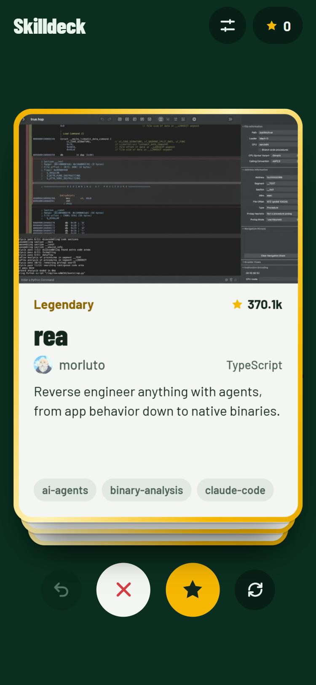

# Skilldeck (working name)

Swipe through Claude skills pulled live from GitHub. Right to save, left to pass, tap to see the skills inside.

<p align="center"></p>

## What it does

- **Live from GitHub.** Cards come straight from GitHub's search API: repos tagged `claude-skills`, `agent-skills`, `claude-skill` or `claude-code-skills`. There is no curated list and no backend.
- **Cards that explain themselves.** Each card shows the repo's README picture (or its first paragraph), description, owner, language and topics. Flip it to list the `SKILL.md` skills inside and to see whether it ships scripts.
- **Rarity by stars.** Common, Rare (100+), Epic (1k+) and Legendary (10k+). Epic and Legendary frames are foil and catch the light as you drag.
- **Filters from the data.** Order by Top, Fresh or New, set a stars range (10+ by default) and hide any topic. The topic chips are built from the repos loaded, not from a fixed list.
- **Saved list.** Everything you swiped right on, with an export to JSON.
- **Phone and laptop.** Drag, use the buttons, or press ← to pass, → to save, ↑ to flip and Z to undo. It can be added to a phone's home screen.

## How it works

The browser calls GitHub directly with no token, so it stays inside GitHub's limits (10 searches a minute and 60 other calls an hour per IP):

- One search per topic, 50 repos at a time, cached on the device for 30 minutes.
- README pictures come from raw.githubusercontent.com, which does not count toward the limit.
- The file tree that lists a repo's skills is fetched only when you flip its card.

A repo gets a card only if its README mentions a skill. This drops repos that add popular topics just to be seen.

Swipes, saves and filters are kept in `localStorage` for now.

## Run it

```bash
npm install
npm run dev
```

`npm test` runs the helper tests (`node:test`). `npm run build` type-checks and bundles into `dist/`, which works from any path.

## Project layout

| File | What it holds |
| --- | --- |
| `src/github.ts` | GitHub search, README art and blurb, spam guard, cache, rarity |
| `src/App.tsx` | Deck paging, swipes, undo, filters, views |
| `src/Deck.tsx`, `src/Card.tsx` | The stack, drag physics, stamps, foil, flip |
| `src/Filters.tsx`, `src/Saved.tsx` | Filter sheet and saved list |
| `src/store.ts` | Device storage |

## Next

- Sync saves across devices with Supabase. The export file is the input for that migration.
- An optional GitHub token for higher limits.
- Deploy to GitHub Pages.
