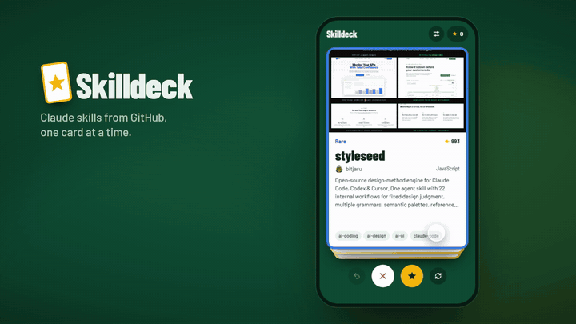
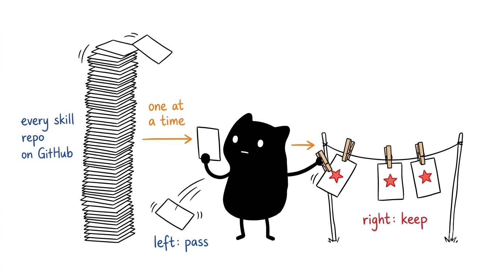
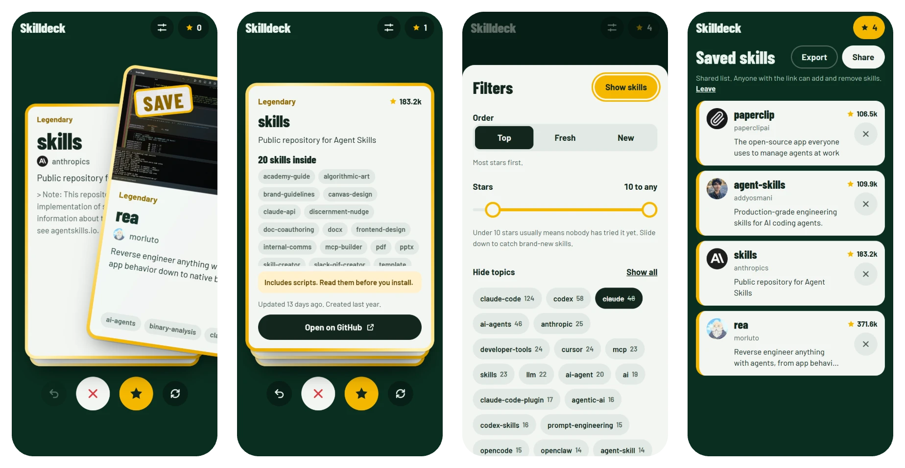
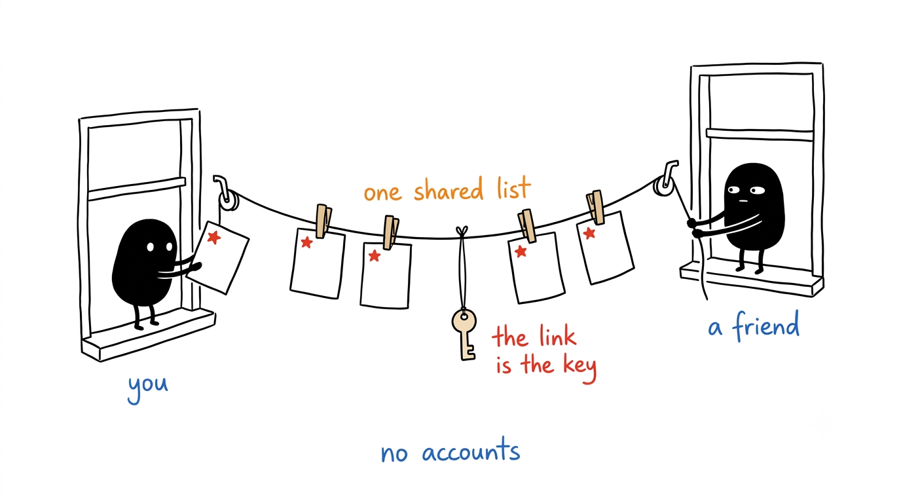

<div align="center">

# Skilldeck

Swipe through Claude skills pulled live from GitHub, one card at a time.<br>
Right to save, left to pass, and share what you saved with friends through a link.

[![React][badge-react]][link-react]
[![TypeScript][badge-ts]][link-ts]
[![Vite][badge-vite]][link-vite]
[![Motion][badge-motion]][link-motion]
[![Supabase][badge-supabase]][link-supabase]
[![License: MIT][badge-license]](LICENSE)

**[Open Skilldeck](https://rudrasomaiya.github.io/skilldeck/)**



</div>

<p align="center"></p>

## About

There are thousands of Claude skill repos on GitHub, and new ones appear every day. A GitHub search gives you a long list of names and star counts, and after the first page they all blur together.

Skilldeck deals them out as cards instead. Each card shows the repo's README picture (or its first paragraph when there isn't one), the description, the owner, the language and the topics. Swipe right to keep it, swipe left to pass, or tap to flip it and see which skills are inside before you decide.

It runs in the browser on a phone or a laptop, and you don't need an account. There's no curated list: every card comes straight from GitHub's search API, so a new skill turns up as soon as it's tagged. Your saves stay on your device unless you share them.

## How it works

<p align="center"></p>

| You do this | You get |
|---|---|
| Swipe right, tap the star or press → | The skill goes on your saved list |
| Swipe left, tap ✕ or press ← | The card leaves your deck |
| Tap the card or press ↑ | It flips to list the skills inside, with a warning if the repo ships scripts |
| Tap undo or press Z | The last card comes back |
| Open the filters | Order by Top, Fresh or New, set a stars range and hide any topic |

Cards get a rarity from their stars: Common, Rare (100+), Epic (1k+) and Legendary (10k+). Epic and Legendary cards have a foil frame that catches the light as you drag.

### Where the cards come from

- The deck is a GitHub search for repos tagged `claude-skills`, `agent-skills`, `claude-skill` or `claude-code-skills`, 50 at a time, merged and deduplicated.
- Repos under 10 stars are hidden by default, since that's where most abandoned ones sit. Brand-new skills start at zero too, so you can slide the minimum down.
- A repo only gets a card if its README mentions a skill. This drops repos that add popular topics just to be found.
- READMEs are read from `raw.githubusercontent.com`, which doesn't count toward GitHub's API limit. Badges are skipped when picking the picture.
- The topic chips in the filters come from the repos loaded so far, not from a fixed list.
- Flipping a card fetches the repo's file tree once and lists every folder that has a `SKILL.md`.

## Share a list with friends

<p align="center"></p>

Tap **Share** on your saved list and Skilldeck turns it into a shared list and gives you a link. Anyone who opens the link sees the same list and can add or remove skills, from any device. There are no accounts. The link is the key, so only send it to people you want in the list.

- Everyone keeps their own deck. Only the saved list is shared, and skills already on it stop showing up in your deck.
- The saves you had before sharing go into the list.
- Changes made offline are kept and sent when you're back online.
- **Leave** takes your device out of the list. You keep a copy of the saves, and the link brings you back.

Shared lists live in Supabase. Without a Supabase project the Share button is hidden and everything stays on the device.

## Running it locally

You need Node.js 22 and npm.

```bash
git clone https://github.com/RudraSomaiya/skilldeck.git
cd skilldeck
npm install
npm run dev
```

Then open http://localhost:5173. `npm test` runs the unit tests, and `npm run build` type-checks and bundles into `dist/`.

### Shared lists

1. Create a free project at [supabase.com](https://supabase.com).
2. Open the SQL editor, paste in [`supabase/schema.sql`](supabase/schema.sql) and run it.
3. Copy `.env.example` to `.env.local` and fill in the project URL and the publishable key.

The publishable key is meant to be public, and it ends up in the site's JavaScript. It can't read or change the table directly: row level security is on with no policies, so the only way in is three functions that each need a list's code. A code is 80 random bits, so nobody stumbles onto a list.

## Deploying

`.github/workflows/deploy.yml` builds the site and publishes it to GitHub Pages on every push to `main`.

1. In the repo, open **Settings → Pages** and set the source to **GitHub Actions**.
2. For shared lists, add two repository variables under **Settings → Secrets and variables → Actions → Variables**: `VITE_SUPABASE_URL` and `VITE_SUPABASE_PUBLISHABLE_KEY`.
3. Push to `main`, or run the workflow from the Actions tab.

The build uses relative paths, so `dist/` also works from any folder on any other static host.

## Project layout

```
skilldeck/
├── src/
│   ├── github.ts        GitHub search, README art and blurb, spam guard, cache, rarity
│   ├── App.tsx          Deck paging, swipes, undo, filters, sharing and views
│   ├── Deck.tsx         The stack, the buttons and the keyboard shortcuts
│   ├── Card.tsx         Drag physics, stamps, foil and the flip
│   ├── Filters.tsx      The filter sheet
│   ├── Saved.tsx        The saved list, Export and Share
│   ├── store.ts         Device storage and the merge for shared lists
│   └── cloud.ts         The calls to Supabase
├── supabase/schema.sql  The table and functions behind shared lists
├── public/              Icons and the web app manifest
└── docs/images/         Images used in this README
```

## Known limitations

- Without a token, GitHub allows 10 searches a minute and 60 other API calls an hour per IP address. Searches are cached on the device for 30 minutes and file trees for a day, but flipping a lot of cards quickly can still hit the limit. When that happens, the app tells you when to try again.
- GitHub search returns at most 1,000 results per query, so a broad filter runs out after 20 pages.
- Anyone with a list's link can add and remove skills. There's no history, so a removed skill has to be found and saved again.
- Supabase's free plan pauses a project after a week with no activity. Shared lists stop syncing until you restore the project from the Supabase dashboard. Changes made in the meantime stay on each device and sync afterwards.
- Stars are a rough signal. A repo with thousands of stars can still be a list of links rather than installable skills. Flipping the card shows which it is.

## Credits

The cards come from the [GitHub REST API](https://docs.github.com/en/rest). Skilldeck is built with [React](https://react.dev), [Motion](https://motion.dev) and [Vite](https://vite.dev), shared lists run on [Supabase](https://supabase.com), and the type is [Barlow](https://fonts.google.com/specimen/Barlow). The illustrations were made with the [Ian Xiaohei Illustrations](https://github.com/helloianneo/ian-xiaohei-illustrations) style.

## License

Released under the [MIT License](LICENSE).

## Author

Made by Rudra Somaiya.

[![GitHub][badge-github]][link-github]
[![LinkedIn][badge-linkedin]][link-linkedin]

[badge-react]: https://img.shields.io/badge/React-149ECA?style=for-the-badge&logo=react&logoColor=white
[badge-ts]: https://img.shields.io/badge/TypeScript-3178C6?style=for-the-badge&logo=typescript&logoColor=white
[badge-vite]: https://img.shields.io/badge/Vite-646CFF?style=for-the-badge&logo=vite&logoColor=white
[badge-motion]: https://img.shields.io/badge/Motion-FFF312?style=for-the-badge
[badge-supabase]: https://img.shields.io/badge/Supabase-3FCF8E?style=for-the-badge&logo=supabase&logoColor=white
[badge-license]: https://img.shields.io/badge/License-MIT-F7DF1E?style=for-the-badge
[badge-github]: https://img.shields.io/badge/GitHub-RudraSomaiya-181717?style=for-the-badge&logo=github&logoColor=white
[badge-linkedin]: https://img.shields.io/badge/LinkedIn-Rudra_Somaiya-0A66C2?style=for-the-badge&logo=data:image/svg%2bxml;base64,PHN2ZyB4bWxucz0iaHR0cDovL3d3dy53My5vcmcvMjAwMC9zdmciIHZpZXdCb3g9IjAgMCAyNCAyNCI+PHBhdGggZmlsbD0iI2ZmZiIgZD0iTTIwLjQ1IDIwLjQ1aC0zLjU2di01LjU3YzAtMS4zMy0uMDItMy4wNC0xLjg1LTMuMDQtMS44NSAwLTIuMTQgMS40NS0yLjE0IDIuOTR2NS42N0g5LjM1VjloMy40MXYxLjU2aC4wNWMuNDgtLjkgMS42NC0xLjg1IDMuMzctMS44NSAzLjYgMCA0LjI3IDIuMzcgNC4yNyA1LjQ2djYuMjh6TTUuMzQgNy40M2EyLjA2IDIuMDYgMCAxIDEgMC00LjEyIDIuMDYgMi4wNiAwIDAgMSAwIDQuMTJ6TTcuMTIgMjAuNDVIMy41NlY5aDMuNTZ2MTEuNDV6TTIyLjIyIDBIMS43N0MuNzkgMCAwIC43NyAwIDEuNzN2MjAuNTRDMCAyMy4yMy43OSAyNCAxLjc3IDI0aDIwLjQ1Yy45OCAwIDEuNzgtLjc3IDEuNzgtMS43M1YxLjczQzI0IC43NyAyMy4yIDAgMjIuMjIgMHoiLz48L3N2Zz4=
[link-react]: https://react.dev
[link-ts]: https://www.typescriptlang.org
[link-vite]: https://vite.dev
[link-motion]: https://motion.dev
[link-supabase]: https://supabase.com
[link-github]: https://github.com/RudraSomaiya
[link-linkedin]: https://www.linkedin.com/in/rudra-somaiya/
